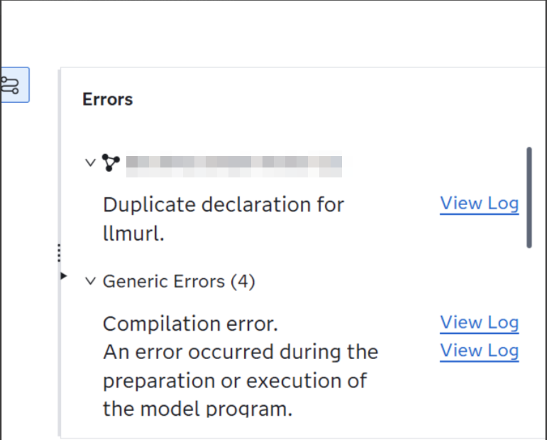

# Troubleshooting Guide

The Troubleshooting Guide tries to provide solution orientied fixes to reported issues. If your issue is not on this please raise an issue or if you already have a solution please contribute it as a pull request.

## SAS Intelligent Decisioning

This part of the troubleshooting guide describes issues that can occur when working with this in SAS Intelligent Decisioning.

### Duplicate declaration for VARIABLE

This error can be encountered during testing within SAS Intelligent Decisioning. Here is how the issue might show up for a variable called **llmurl**:



```SAS
ERROR: Compilation error.
ERROR: Line 167: Duplicate declaration for llmurl.
```

This error occurs when your model (for example the prompt template model) has the same variable twice in its *Variable* tab inside of SAS Model Manager. If that is the case, you have identified the source of the error. In order to fix this, please ensure that you are using the current version of the *Prompt Builder UI* (compare the versions using the [project CHANGELOG](https://github.com/sassoftware/sas-agentic-ai-accelerator/blob/main/CHANGELOG.md)). If you created the model not using that tool, please make sure that model variables are correctly updated when creating new versions of the model.

### DS2 "pymas" package encountered a failure in the 'execute' method

This error can be encountered when testing or running a decision that contains a prompt template that was manifested with the *Include the LLM call in the manifested model* option:

```SAS
ERROR: Line 53: DS2 "pymas" package encountered a failure in the 'execute' method.
```

It means that the Python score code of the model raised an unhandled error. The most common cause is the LLM call itself failing — for example because the certificate of the endpoint hosting the LLM containers is not trusted or the endpoint is not reachable from where the model runs. Here is how to address it:

1. Ensure that you are using the current version of the *Prompt Builder UI* (compare the versions using the [project CHANGELOG](https://github.com/sassoftware/sas-agentic-ai-accelerator/blob/main/CHANGELOG.md)) and manifest the prompt again. Since version 1.0.0 a failing LLM call no longer raises an error: the failure reason is returned through the *response* output of the model (e.g. *LLM call failed: ...*) and *parse_status* returns 0. Keep the *response* output selected while validating a decision, so you can see why a call failed.
2. If the *response* output reports a TLS/certificate problem: the model verifies the connection against the CA bundle at */security/trustedcerts.pem*, which SAS Viya mounts into the pods of CAS and of the compute servers and which covers LLM containers hosted behind the SAS Viya ingress. If your LLM containers are hosted elsewhere, point the *LLMCONTAINERCABUNDLE* environment variable to a CA bundle that covers them — see [Deployment of Decisions](./Deployment-of-Decisions.md) for all supported environment variables and how to set them per runtime. If the problem only shows once the decision is published to MAS, see [CERTIFICATE_VERIFY_FAILED in the response of a published model](#certificate-verify-failed-published-model) below.
3. If the model fails at publish time instead (*py.publish() failed*), the *requests* package is most likely missing from the Python environment. The manifested model ships a *requirements.json*, so SAS Container Runtime destinations install the package automatically during publishing; for runs in SAS Intelligent Decisioning tests, CAS or MAS, an administrator has to make the *requests* package available in the configured Python environment.

Please note that the *Call LLM node* path (prompt templates manifested without the included LLM call) is not affected by this — for that path see the Micro Analytic Service and SAS Container Runtime sections below.

## Micro Analytic Service

This part of the troubleshooting guide describes issues that can occur when publishing decisions or models that call the LLMs to the SAS Micro Analytic Service (MAS).

### 500 Internal Server Error - EXECUTEMETHOD failed for HTTP POST method with URL

This error occurs because the endpoint under which the LLMs are hosted doesn't have a valid certificate from the standpoint of your SAS Micro Analytic Service. This fix has to be done by an administrator with the ability to patch the SAS Viya deployment - for more information check out the [SAS documentation](https://go.documentation.sas.com/doc/en/mascdc/default/masag/p0kuxnv51taahin1cf23yhr0g23z.htm):

1.   Go to *$BASE_PATH/sasinstall/sas-bases/examples/sas-microanalytic-score/config* and copy the *mas-add-environment-variables.yaml*
2.   Then adjust the yaml in the following way - this assumes that you have deployed the LLMs behind the same ingress as SAS Viya if not you need to point it to your certificate accordingly:

```yaml
---
apiVersion: builtin
kind: PatchTransformer
metadata:
  name: mas-add-environment-variables
patch: |-
  - op: add
    path: /spec/template/spec/containers/0/env/-
    value:
      name: SSLCALISTLOC
      value: /security/trustedcerts.pem
target:
  group: apps
  kind: Deployment
  name: sas-microanalytic-score
```

3.   Add the transformer to your *kustomization.yaml* and apply it.
4.   Check the environment variables of the sas-microanalytic-score pod definition and there under the sas-microanalytic-score container check that the environment variable was added accordingly.
5.   Now rerun your the decision/model call and check that the error has been actually fixed.

### CERTIFICATE_VERIFY_FAILED ... self-signed certificate in certificate chain in the response of a published model {#certificate-verify-failed-published-model}

This error can be encountered in the publishing validation of a decision on a MAS destination, when the decision contains a model that calls the LLM or decision model container itself: a prompt template manifested with the *Include the LLM call in the manifested model* option, a decision template, or the retrieval model of a RAG setup. The validation ends without an error, and every row carries the message in the model's text output (*response*, *answer* or *retrieval_status*) while the other outputs are empty:

```text
Decision model call failed: HTTPSConnectionPool(host=..., port=443): Max retries exceeded with url: /llm/von_1_2/von_1_2 (Caused by SSLError(SSLCertVerificationError(1, '[SSL: CERTIFICATE_VERIFY_FAILED] certificate verify failed: self-signed certificate in certificate chain')))
```

The same decision returns answers in the in-app test of SAS Intelligent Decisioning, and a decision that uses the *Call LLM node* works on the same destination. The cause is that MAS runs the Python code of the model in a separate runner container that does not have the CA bundle (*/security/trustedcerts.pem*) the main container has. This fix has to be done by an administrator with the ability to patch the SAS Viya deployment:

1.   Confirm the cause and mount the bundle into the Python runner container as described in [Publishing to SAS Micro Analytic Service: the certificate bundle](./Deployment-of-Decisions.md#mas-certificate-bundle). That keeps TLS verification on and is the fix for production.
2.   Check that */security/trustedcerts.pem* is listed inside the runner container, with the command given there.
3.   Run the publishing validation again and check that the rows carry answers.

On a test system with a closed cluster network, verification can be switched off instead — with the option **Verify TLS certificates in manifested models** of the Prompt Builder, followed by manifesting the model again, or with the environment variable *LLMCONTAINERSSLVERIFY=false* on the destination (*RAGEMBED_SSLVERIFY=false* for a retrieval model). The model then no longer checks which container answers; the same section says when that is acceptable.

## SAS Container Runtime

This part of the troubleshooting guide describes issues that can occur when publishing decisions or models that call the LLMs to a SAS Container Runtime (SCR) publishing destination (independent of AWS, Azure, GCP or Private Docker).

### SSL Error: Missing CA trust list

This error is mostly likely caused by the fact that you are using a certificate for the LLM containers that isn't valid according other SCR containers - this might be because you are using a self-signed certificate or organization signed. This fix has to be done by the person that deploys the container - for more information check out the [SAS documentation](https://go.documentation.sas.com/doc/en/mascrtcdc/default/mascrtag/p0r7reghey2nmsn1lubyxbibzwjh.htm):

```yaml
---
apiVersion: apps/v1
kind: Deployment
metadata:
  name: <CONTAINER>
  namespace: <NS>
spec:
  selector:
    matchLabels:
      app: <APP_NAME>
  template:
    metadata:
      labels:
        app: <APP_NAME>
    spec:
      containers:
      - name: <APP_NAME>
        image: <CONTAINER_REGISTRY>/<CONTAINER>:latest
        resources:
          requests:
            memory: "4000Mi"
            cpu: "1000m"
        ports:
        - containerPort: 8080
          protocol: TCP
        env:
        - name: SAS_SCR_SSL_CERTIFICATE
          value: /ssl/certificate-file.crt
 ... Shortend for brevity
```

Please note that you have to mount the certificate file in a volume to the container!