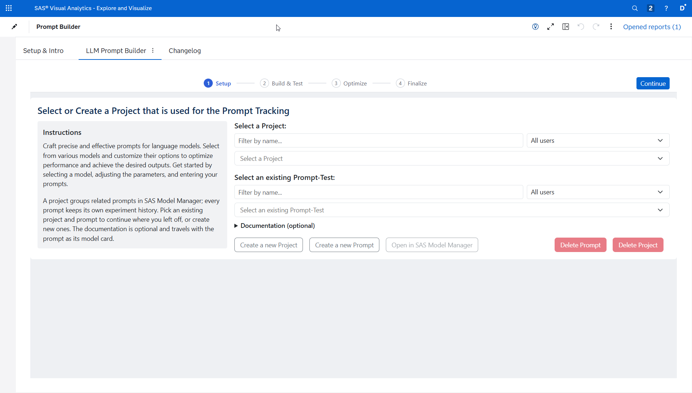
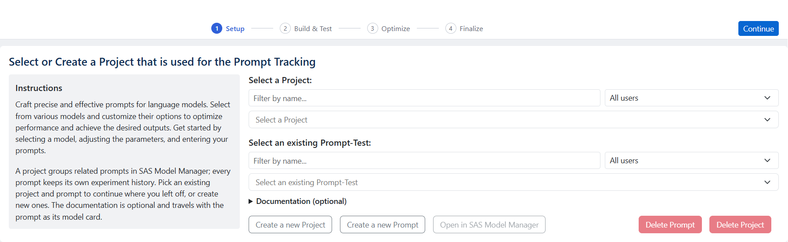
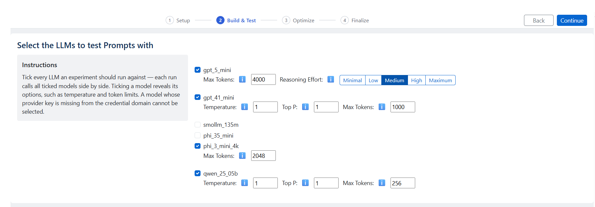
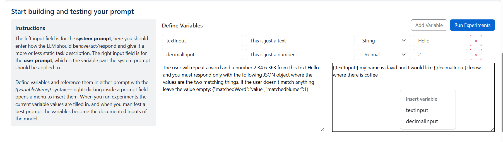
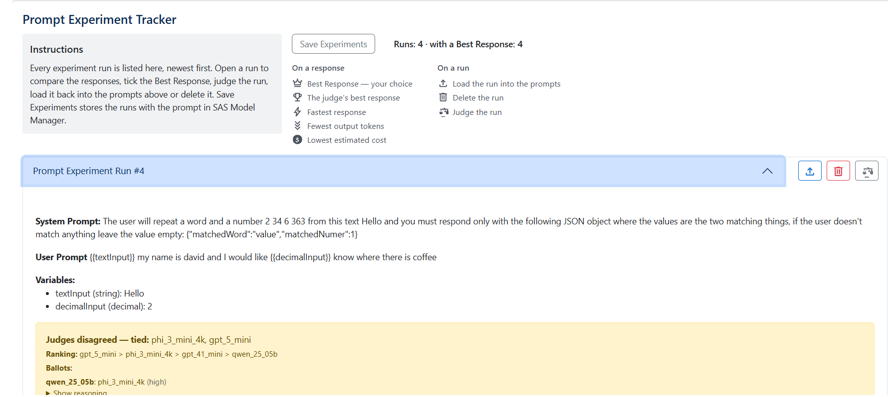
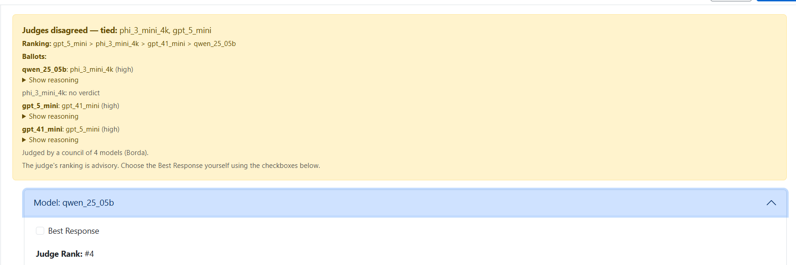
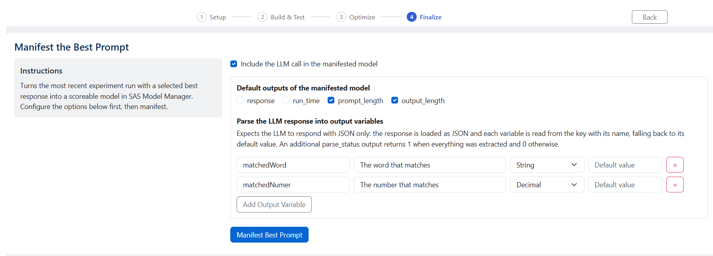

The **LLM Prompt Builder** is a no-code tool for prompt engineers. You test a prompt across several LLMs at once, compare the responses side by side, let an LLM judge which one is best, keep a versioned history of every experiment, and turn the winning prompt into a scoreable model you can use elsewhere on the platform — for example in SAS Intelligent Decisioning. Everything is saved in SAS Model Manager, so your work is governed and shareable.

The same tool builds two more kinds of things, chosen on its first card under *What are you building?*: a [decision template](#decision-templates) for decision models, and a [RAG setup](#rag-setups) for a document collection. Which of them you see depends on what your administrator has switched on; where only prompt templates are offered, the question is not shown at all.

This guide walks through using the tool, prompt templates first. For installing and embedding it in a SAS Visual Analytics report (and the one-time configuration a report author does), see [Deploying the Builder UIs](../Administration-Guide/Setup-Additional-UIs.md).

## The workflow in one minute

The page is a flow of steps, shown as a slim stepper across the top with **Back** and **Continue** beside it. Which steps it has depends on the kind you are building; for a prompt template they are:

| Step | What you do there |
| --- | --- |
| **1 Setup** | **Choose the kind**, where more than one is offered, then **pick a project and a prompt-test** — where this experiment history is stored in Model Manager. You do this once per session. |
| **2 Build & Test** | The workbench, where the whole loop happens on one page: **choose the LLMs** and tune their options, set how responses are **judged**, **write your prompt** — a system prompt and a user prompt, with optional variables — **run the experiment**, then compare the responses in the tracker right below, **mark the best response** and **save**. |
| **3 Optimize** | Only when your administrator has enabled prompt optimization: let DSPy rewrite the prompt from your Best Response runs. Without it the flow has three steps and **Finalize** is step 3. For a **decision template** this step is **Evaluate** instead (see [Decision templates](#decision-templates)). |
| **4 Finalize** | **Manifest the best prompt** — turn it into a scoreable model for the rest of the platform. Always the last step. |

You can open any step at any time by clicking it; nothing is locked, and only the step you are on is highlighted — steps are places to work in, not tasks that get ticked off, so revisit or skip them as you need. Editing, running and reading all stay on **Build & Test**: a finished run appears at the top of the tracker below the prompts, and loading an earlier run brings you back up to them; loading an optimized prompt from the **Optimize** step opens **Build & Test** for you. Every card explains itself in an **Instructions** box on its left; beside the tracker's instructions a summary counts your runs and those with a Best Response, and a legend explains the icons a run shows.

A decision template keeps these steps with **Evaluate** in the place of Optimize; a RAG setup has four steps of its own — *Setup*, *Documents & chunks*, *Store & output*, *Run & test* — described under [RAG setups](#rag-setups).

Nothing is sent to SAS Viya until you have the configuration in place, and no paid model call happens until you press **Run Experiments**.

## Pick a project and a prompt-test

At the top, choose an existing **project** or create one. A project is a Model Manager container that groups related prompt-tests; the Prompt Builder tags the ones it creates so they are easy to find. Inside a project you choose or create a **prompt-test** — this is the thing whose experiment history you are building. Both pickers are **type-to-filter comboboxes** — click one and start typing to narrow the open list live — and each additionally has a "created/modified by" filter, so long lists stay manageable.

Use **Create a new Project** / **Create a new Prompt** to add them without leaving the tool. Both need a name: with the name field empty, or holding nothing that is displayed — blanks, or characters such as a zero-width space, which a name pasted from elsewhere can bring along — nothing is sent to SAS Model Manager: the dialog says *A project name is required.* or *A prompt name is required.*, marks the field and puts the cursor into it. What is created is what stood in the dialog when you clicked; while the creation is out, the name and the description cannot be edited. The dialogs that create a RAG project and a RAG setup do the same. **Delete Prompt** and **Delete Project** remove them again; before deleting, the tool checks whether any SAS Intelligent Decisioning decisions still use the prompt and warns you, so you do not break a running decision by accident. The confirmation lists those decisions, each with a link, or says that none was found, or says that the usage could not be verified — the prompt may then still be in use. Decision templates and RAG setups get the same note before they are deleted.

Selecting a prompt-test loads its saved experiment runs into the **Prompt Experiment Tracker** on the **Build & Test** step, and brings the most recent run you marked as best straight into the workbench so you can carry on where you left off.

## Choose the LLMs and tune their options

The LLM list shows every model available in your environment's LLM project. Tick each model you want to include in the comparison. When you tick one, its **options** appear — temperature, top-p, top-k, maximum length/tokens and any model-specific settings. Each option has an **ℹ️ info icon**; hover or focus it for an explanation of what the setting does and a sensible range.

You can select as many models as you like; they all run against the same prompt so you get a true side-by-side comparison. Models an administrator has marked as deprecated are hidden from the list.

## Write your prompt

The workbench has two boxes:

- **System prompt** — how the model should behave: its role, tone, task and any rules. This is the mostly-static part.
- **User prompt** — the variable input the system prompt acts on.

### Variables

Real prompts rarely use fixed text. Define **variables** above the prompt boxes — each has a name, an optional description, a type (string or decimal) and a value — then reference them anywhere in either prompt with the `{{variableName}}` syntax. Right-click inside a prompt box to insert a defined variable at the cursor.

When you run an experiment, the current values are filled in before the prompts are sent. Variables are more than a convenience: when you later manifest the best prompt, they become the documented **inputs** of the resulting model, so the model's callers know exactly what to supply.

## Run the experiment

Press **Run Experiments**. The tool sends the resolved prompts to every selected model in parallel and, when they return, shows each model's result in the tracker: the response (rendered as Markdown), the time to respond, and the input/output token counts. Two mechanical flags are added automatically for the run — a ⚡ icon on the **fastest** response and a ⌄ icon on the one with the **fewest output tokens**. Each response is a starting point; speed and length are not quality, which is where judging comes in.

## Judge the responses

Speed and token count do not tell you which answer is actually best. The **Judge the responses** section lets another LLM do that for you.

1. Pick a **judge model**. A deployment can set a default, but you can always override it here. Choose a model that is *not* one of the ones you are comparing where possible — a model tends to over-rate its own style (self-preference bias).
2. Optionally tick **Auto-judge when the experiment finishes** so judging runs by itself after every experiment, or leave it off and judge on demand.
3. Press **Judge this run** on any run in the tracker.

The judge sees all of the run's responses at once, in a shuffled order and under anonymous labels (so position and brand cannot sway it), reasons about them step by step, and returns a ranking. The result appears as a banner on the run: the **winner**, the full **ranking**, a **confidence** level, and the judge's **reasoning** behind a "Show reasoning" toggle. The best-ranked response also gets a 🏆 icon next to the ⚡ and ⌄ icons, and each response shows its **judge rank**.

:::note The judge is advisory
Judging never changes your **Best Response** selection — that stays a decision you make. The judge rank is a signal to help you decide, alongside the responses themselves and the run metrics.
:::

**Include the judge's own response.** By default, if your judge model is also one of the models being compared, its own response is left out of the ranking to avoid self-preference bias. The **Include the judge's own response** toggle overrides that if you want it ranked anyway — its ℹ️ icon explains the trade-off. Judging needs at least two responses to compare, so if excluding the judge would leave only one, either include it or pick a different judge.

The judge model, the include-self setting, the auto-judge setting and the full verdict (including the reasoning) are saved with the run, so loading a run later restores everything exactly as it was judged.

## Mark the best response and save

Tick **Best Response** on the model result you consider best. This is the choice that matters: it is what a manifested model is built from and what downstream monitoring reports on. You can change it at any time.

Press **Save Experiments** to persist the run history to the selected prompt-test in Model Manager. Saving creates a new model **version**, so you keep a full, auditable trail of how a prompt evolved. **Open in SAS Model Manager** jumps straight to the prompt's files there.

**If a red line beside the button says that saving the experiments did not finish**, a request to SAS Model Manager failed or got no usable answer. The experiments stored with the prompt-test may then be the earlier ones, the ones on the page, or missing. The runs are still on the page: press **Save Experiments** again before you leave it.

### The experiment tracker

Every run you save is listed in the tracker, newest first. For each run you can:

- **Load** it back into the workbench — prompts, variables, the selected LLMs and their options, and the judge configuration are all restored.
- **Delete** it — the remaining runs renumber cleanly.

## Manifest the best prompt

Once a run has a **Best Response**, **Manifest the Best Prompt** turns it into a scoreable model in SAS Model Manager, ready to be consumed elsewhere — most commonly by the *Call LLM* node in SAS Intelligent Decisioning. The variables you defined become the model's input variables (with their descriptions), and the prompt text is baked into the score code.

Two options shape what you get:

- **Include the LLM call in the manifested model.** Off by default: the model returns the request body and endpoint (`llmBody`, `llmURL`) for the *Call LLM* node to execute. On: the model calls the LLM container itself and returns the response and metrics directly.
- **Parse the LLM response into output variables.** If your prompt asks the model to reply with JSON, define the output variables you expect; the model then reads each one from the response, falling back to a default, and adds a `parse_status` output that reports whether everything was extracted.

**If Finalize shows a warning about TLS verification**, your administrator has switched off **Verify TLS certificates in manifested models**: a model manifested now with the included LLM call does not check the certificate of the model container it calls, and carries the tag `TLS-Verification-Off` in SAS Model Manager. The warning is shown before you click, for a prompt only while **Include the LLM call in the manifested model** is ticked — a prompt manifested for the *Call LLM* node makes no call itself and is not tagged. It names the option and the environment variable (`LLMCONTAINERSSLVERIFY=true`) that turns verification back on where the model is deployed. Manifesting the model again once the option is ticked removes the tag. The setting is meant for test systems — ask your administrator before you manifest a model that is going to production.

**If the line beside the manifest button starts with *Not manifested* or *The manifest was not completed***, the manifest did not go through, and no message says that the model was manifested. *Not manifested* means that the model still holds the score code and the tags it had before the click, and the line goes on to say why: a variable or a question of the saved run has a name the score code cannot use (rename it, run again and manifest from that run), the experiments could not be saved (the click saves them before it manifests — the line above it says what happened to the save; save the experiments, then manifest again), SAS Model Manager refused the new score code, or a request to it failed before the score code was stored — no answer at all, or an error page in place of one. *The manifest was not completed* means that a request failed at the score code or after it, and the line says which. When *the score code of this run is stored*, the requirements file (`requirements.json`) and the attributes of the model may be missing or still those of an earlier manifest. When *it is not known whether the score code of this run is stored*, the request that stores it got no answer, and SAS Model Manager may have stored it all the same: the tags of the model were not updated, so the tag `TLS-Verification-Off` may not match the score code the model holds until you manifest again. The button can be used again in every case. Where a request failed, manifest again; if that fails too, check the connection to SAS Viya and your permissions on the model. The same lines appear for a decision template.

A line that says the tag `TLS-Verification-Off` could not be written, or that the tags could not be updated, is another case: the score code of this run is stored and the manifest goes on, so the message that the model was manifested can appear with it. The line asks you to put the tag right in SAS Model Manager.

From here the manifested model behaves like any other model on the platform — see [Deployment of Decisions](../Administration-Guide/Deployment-of-Decisions.md) for using it in a decision flow.

## Optimize the prompt (optional)

When your administrator has [enabled prompt optimization](../Administration-Guide/Enabling-Prompt-Optimization.md), the flow gains an **Optimize** step between **Build & Test** and **Finalize**. Its **Metric Guide** and **Optimizer Guide** boxes summarise the choices next to the pickers, and a notice above **Run optimization** says what is still missing while the run is blocked. It closes the loop *judge → optimise → judge again*: instead of you rewriting the prompt by hand, [DSPy](https://dspy.ai) searches for a better version automatically — using the runs you marked as **Best Response** as the examples of what a correct answer looks like.

1. Pick the **target LLM** the prompt should be optimised for — or, if you are not sure which model to invest in, use **Compare targets…** next to the dropdown first (see [Comparing target models](#comparing-target-models)).
2. Choose the **dataset**. By default it is this prompt's experiments: every saved run with a Best Response becomes one training example — the panel shows how many usable runs you have and requires a minimum (30 by default); the responses you vouched for are treated as *correct*, so make sure they are. Alternatively pick **a governed CAS table** from the cascading **server → caslib → table dropdowns** — the lists come straight from CAS, so only tables that are actually loaded appear. The caslib and table pickers are **type-to-filter comboboxes**: click one and start typing, and the open list narrows live as you type; picking an entry (or pressing Enter on the only remaining match) selects it, and leaving the field without picking keeps your previous selection. The table needs one column per prompt variable plus a `response` column with the reference answer (your administrator can build one with the shipped `Create-Optimization-Dataset.sas` template); the panel additionally checks the table's columns and row count before launching.
3. Choose the **metric**: *exact match* (the optimised prompt must reproduce your Best Responses, ignoring case and surrounding punctuation), *token overlap* (an F1 score over the words shared with the Best Response — partial credit for close answers, a good default for chatty models and longer references), or an *LLM judge* that sees the task and scores whether a response conveys the same answer as your Best Response, using the same rubric as the judging section (accuracy, relevance, completeness, clarity). Pick a judge that differs from the target LLM.
4. Choose the **optimizer**: *Bootstrap few-shot* (the default — keeps your instruction and selects the strongest worked examples to teach with), *MIPROv2* (additionally proposes and trials rewritten instructions, so the optimised system prompt itself can change — it makes noticeably more model calls, which the estimate reflects), or *GEPA* (evolves the instruction from natural-language feedback — it needs a judge model for its reflection step even when the metric is not the judge, and makes the most calls of the three).
5. Press **Run optimization**. The prompt is saved first, then the work runs as a SAS job on the server — the panel shows live progress (dataset loaded, baseline scored, optimising, writing back), and a collapsible **Run log** tracks the job's runtime and milestones. A run makes many model calls and takes several minutes.

When the job finishes you see the metric **before → after**, and the run joins the prompt's **Optimization history** right below — every run stays on the prompt itself (no extra models are created). Expand a run to see its **evolution**: the baseline vs. the optimised system prompt, the few-shot examples the optimizer selected, a per-example before/after table where the answers the optimisation fixed are highlighted, and what the run **spent** — the model calls it made, the token totals, and an estimated cost. **Load as experiment** puts the optimised prompt back into the workbench with its variables and the target LLM pre-selected — run it, judge it against the original (Phase 1/2), and only manifest it if it actually wins. Like judging, optimization is advisory: it never changes your prompt or your Best Response choices by itself.

### Choosing the dataset, metric and optimizer

**When is optimization useful?** DSPy shines when you can say what a *correct answer* looks like but tinkering with the wording hasn't gotten you there: a model that answers correctly but ignores your format, a prompt that works on easy inputs and fails on edge cases, or a task where you suspect a few well-chosen worked examples would help but don't want to pick them by hand. It is *not* the right tool when you have only a handful of examples (the optimizer will overfit them), when no metric can meaningfully score an answer, or when the prompt already scores perfectly — there is nothing left to climb. The job guards that last case for you: if the baseline scores 1.0 on the validation split it **skips the optimization phase** after only the baseline calls, records the run with a note, and suggests harder examples or a stricter metric instead.

**Picking the metric** — the metric *is* the optimization target, so pick the one that actually measures your task:

| Metric | Use when | Watch out for |
| --- | --- | --- |
| **Exact match** | The reference is a single word or a fixed format (categories, codes, yes/no). Case and surrounding punctuation are ignored. | Scores 0 for *any* deviation — chatty models score badly for wording alone. |
| **Token overlap** | Free-form text where the right answer shares its words with the reference (summaries, extractions, short explanations). Partial credit via an F1 score over shared words. | Rewards word overlap, not meaning — a fluent paraphrase with different words scores low. |
| **LLM judge** | The reference can be *said differently* and still be right; meaning matters more than wording. | Each scored example costs an extra judge call; pick a judge model that differs from the target. |

**Picking the optimizer:**

- **Bootstrap few-shot** (default) keeps your instruction untouched and selects worked examples (demos) that teach the model the task. It is fast, cheap and a good first run — if demos alone fix your prompt, stop there.
- **MIPROv2** additionally *rewrites the instruction itself*, proposing and trialling candidates against your metric. It is the stronger tool when the instruction is the problem, at the price of many more model calls (the panel's estimate scales accordingly) — and it needs the `optuna` package in the compute context ([admin guide](../Administration-Guide/Enabling-Prompt-Optimization.md)).
- **GEPA** also rewrites the instruction, but *reflectively* instead of by blind trial: after each round, a **reflection model** (the judge model you pick in the panel) reads *why* the failing answers scored poorly and proposes a targeted improvement. With the **LLM judge** metric that feedback is the judge's own reasoning — the strongest combination, because the optimizer literally learns from the judge's critique; with exact match or token overlap the feedback is a generated expected-vs-produced note. GEPA selects no few-shot examples (the max-examples setting doesn't apply) and makes by far the most model calls of the three — a live 10-example run made roughly 800 calls over about half an hour — so use it when MIPROv2 plateaus or the task needs nuanced instructions. It needs no extra package: its engine ships with dspy itself.

Every finished run reports what it actually spent — the model calls it made per role (target/judge), the token totals, and an **estimated cost** priced with the same per-token/per-second attributes as the run table — in its Optimization-history entry.

### Comparing target models

**Compare targets…** (next to the target dropdown) answers a different question than a single optimization run: *which of my deployed models should I invest in for this prompt?* Pick two or more candidates in the dialog and choose one of two modes:

- **Screen only** (default) scores your *current* prompt on every candidate over the dataset — no optimizer runs, so it costs roughly one call per example per candidate and finishes in minutes. The result is a **ranked table** in the optimization history: quality (by your chosen metric), average model latency per call, calls made, and an estimated cost per candidate — best quality first, lower latency breaking ties. A candidate whose container is unreachable gets flagged instead of failing the whole comparison. Each row offers **Optimize this target**, which pre-selects that model in the panel so the normal single-target run continues from there. Mind the caveat: screening ranks models on the *unoptimised* prompt. A small model that looks weak here can improve dramatically once optimised (demos teach it the format) — treat screening as a way to weed out clearly unsuitable candidates, not as the final verdict between close ones.
- **Also optimize each candidate** runs the panel's configured optimizer on *every* candidate and ranks them by the **optimised** metric — the truthful comparison, at many times the cost (the estimate scales accordingly). Each row then shows that candidate's *before → after* and offers to **load its optimised prompt** into the workbench directly. Because this mode trains per candidate, the full minimum-sample requirement applies (screening only needs 10 examples, with a noise warning below 30).

The recommended flow is both in sequence: **screen first to shortlist, then sweep only the shortlist** — or hand-pick the screening winner and run a normal single-target optimization on it.

### Building a CAS dataset table

The "governed CAS table" dataset source expects this schema (column names are matched **case-insensitively**):

- **One column per prompt variable**, named exactly like the variable in the variables manager. A prompt using `{{word}}` needs a column `word`; a prompt using `{{customer}}` and `{{amount}}` needs both columns.
- If the prompt has **no variables**, a single column `userPrompt` holding the full user prompt of each example.
- A column **`response`** with the reference answer the optimization steers toward. Rows with an empty `response` are skipped.

For example, for a prompt with a `{{word}}` variable:

| word | response |
| --- | --- |
| hot | cold |
| big | small |
| fast | slow |

The table must be **loaded (promoted) into memory** in a caslib the optimization compute context can reach — the panel's table dropdown only lists loaded tables, and the shipped [`Create-Optimization-Dataset.sas`](https://github.com/sassoftware/sas-agentic-ai-accelerator/tree/main/SAS-Viya-Integrations/Prompt-Optimization/Create-Optimization-Dataset.sas) template builds and promotes a correctly-shaped table you can adapt. Two more things to know: the prompt itself (system prompt, user template, variables) still comes from the prompt's last saved run, so **save at least one experiment first**; and before launching, the panel validates the chosen table's columns against your prompt's variables and its row count against the sample minimum, naming exactly what is missing.

## Decision templates

A prompt-test can also be a **decision template**, for the **decision models** your administrator registers (Jev, Von - see the [Decision Definitions](../Administration-Guide/Decision-Definitions.md) page). A decision model does not write text: it takes a **state** - a ticket, a record - and **typed questions**, and returns a calibrated answer per question. That inverts the design work. The state is close to a pass-through of the record, and the questions are the prompt and the output structure at once.

**When a decision template is the right kind.** When the answer is one of a fixed set of labels, a yes/no or a level - routing, triage, screening an input, judging an output - a decision model answers in a fraction of a second and of the price of an LLM, with a probability you can gate on. It is the wrong kind for anything that must be written, computed or explained. The rules that hold for every deployment, measured on the models the framework ships: **always offer a way out** (an `unknown` or `none` option - without one the model invents an answer, and a threshold cannot catch it); **compute in code, decide in the model** (arithmetic, counting and dates fail on most decision models - pass the computed value in the state); **calibrate before you set a threshold** (the Evaluate step shows how far the confidence runs from the accuracy); **rules own the invariants** (amount limits and never-auto-deny checks belong in the ruleset of the decision flow, the model ranks and routes); **no reasons come back** (where a decision needs a written reason, the model triages and an LLM or a person explains the escalated cases); and **route the uncertain slice** to a person or an LLM - that hybrid matched or beat the LLM alone at a fraction of the cost in independent studies. The Prompt Builder keeps the same steps and the same governance (project, prompt-test, tracker, manifest) and swaps the pieces that differ:

- **Setup**: the card starts with the question *What are you building?* - a prompt template for LLMs, a decision template for decision models, or a [RAG setup](#rag-setups) - with a sentence on each. A kind your administrator has switched off is not among the cards, and with a single kind left the question is not shown. Each view lists its own projects and prompt-tests: a project created in the decision view is made for decision templates (it carries the `Decision-Engineering` tag beside `Prompt-Engineering`), and every project from before holds LLM prompts and stays in the LLM view. The kind is stored with the project and with the prompt-test, so both open as what they are every time. The model list on *Build & Test* then shows the decision models instead of the LLMs, and the judge card disappears - there is nothing to judge.
- **Build & Test**: instead of two prompts you write a **state template** (text or JSON, with `{{variables}}` inserted like in a prompt) and design the **questions**: a name (it becomes an output of the manifested model), a type, instructions, and the options of a *choice* (`key: description`, one per line) or the levels of a *score* (lowest first). A yes/no *noul* needs nothing more. You can **start from a template** - ticket routing, an agent guardrail, a prompt-injection screen, claims triage, complaint classification, an LLM-as-a-judge, RAG chunk relevance, an out-of-scope check - and change it; every field has a **?** that explains what it does and what was measured. Give a question an **expected answer** for the current variable values and the run is checked for you: a run whose answers all match is ticked **Correct** - the decision-template reading of *Best Response* - and you can still change the tick.
  - **The designer checks your questions as you type.** Things to *fix* (no name, no instructions, fewer than two options) block the run; *warnings* and *tips* do not, but read them: a choice **without an escape option** (`unknown`, `none`) makes the model invent an answer when the text fits nothing - in the measurements behind this guidance Jev put 0.88 on an invented answer, and a confidence threshold does not catch that - so a new choice starts with `unknown` and a one-click fix adds it to an existing one. Instructions that ask the model to **calculate, count or compare dates** fail on most decision models (compute the value in your code and put it in the state), asking **why** gets no answer (decision models return no reasons), and **extraction** is not what they do. A checklist under the questions sums it up, and the state shows its token estimate.
  - **The model cards** say what each decision model is and takes - provider, licence, context, option limit, question types, the price of the current request per thousand calls - and whether it **fits** the request. A model that cannot take it (a score question on a choice-only model, more options than it accepts) is skipped by the run and named, not failed.
  - **The tracker reads every answer for you**: one sentence on how sure the model was (a clear decision, a preference, a close call, an abstention) and a badge saying what a flow gated at the default threshold would do - *automate*, *escalate*, or *abstained* when the model chose the escape option. A confident choice from a question without an escape option is flagged as possibly invented. Each model's probability per option or level is drawn beside it, and when several models answered one run their top answers stand side by side, marked *all agree* or *models disagree* - disagreement means the input is ambiguous or the options overlap.
- **Evaluate** (step 3): a decision model cannot be read like a response, so it is measured on cases with a known answer. Use the saved runs that carry expected answers, or a CAS table with one column per variable and an `expected_<question>` column per question; every row is one call per selected model. You get the accuracy per question (abstentions counted apart), a confusion table for choices (rows: expected, columns: answered), the **confidence threshold** trade-off - move the slider and read how many cases stay automatic at that threshold (coverage) and how often those are right - and the **calibration**: the expected calibration error, the Brier score and a reliability diagram of accuracy per confidence bin against the diagonal. Read the calibration before you set the threshold: a threshold on a confidence that runs ahead of the accuracy automates mistakes. That threshold is the number your decision flow branches on - cases below it go to a person or an LLM.
- **Finalize**: the manifested model takes the state template's variables as inputs, bakes the questions in, calls the decision model itself, and returns one typed pair per question - `<name>` (the chosen option, `yes`/`no`, or the level number) and `<name>_confidence` - beside the whole answer map, the first question's headline answer and confidence, and the call's time and token count. No JSON parsing, no `parse_status`. A decision template always calls its model itself, so the [warning about TLS verification](#manifest-the-best-prompt) applies to it whenever your administrator has switched verification off.

## RAG setups

The third kind on the Setup card is a **RAG setup for a document collection**, and it is not a prompt at all. A RAG setup is one folder of documents wired to one collection in a vector store, together with everything that decides how the documents get there: which embedding model turns text into vectors, how the text is cut into chunks, whether a prompt enriches each chunk, and where the pipeline keeps its tables. Saved, it is a governed model in SAS Model Manager, as a prompt-test is. Manifested, it becomes an ingestion job that keeps the collection current and a retrieval model a decision can call. This part of the Prompt Builder is called the **RAG Builder**.

What retrieval-augmented generation is, and what the pipeline does with your documents, is the subject of the [RAG guide](./RAG.md). This section is about the screen.

**Choosing the kind swaps the steps.** A RAG setup has nothing to run an experiment on, so it does not reuse the prompt steps: choosing it replaces them in the stepper with four steps of its own. The same question, *What are you building?*, sits at the top of the RAG Builder's Setup card and takes you back.

| Step | What you do there |
| --- | --- |
| **1 Setup** | Pick or create a **RAG project** and a **RAG setup** inside it — a project groups related setups, a setup is one document corpus wired to one collection. Write its **documentation** here too: what the corpus is, what it should be used for and where its limits are. It is saved onto the model, so a governance review reads your own caveats. |
| **2 Documents & chunks** | Name the **document folder**, choose the **embedding model** from the ones registered in your environment, set the **chunking**, and optionally add **enrichment** — prompts called once per chunk. The embedding model comes before the chunking because its token window caps the chunk size. |
| **3 Store & output** | Choose the **vector database** and the collection, the caslib and prefix of the **pipeline tables**, and the folder for the **generated artifacts**. **Save setup** stores the settings of every step in SAS Model Manager. **Manifest setup** saves too, then generates the ingestion job, the SAS Studio flow and the retrieval model. |
| **4 Run & test** | **Launch ingestion** runs the manifested job against the document folder and reports its milestones. A run in which some documents could not be ingested still ends as completed, with a warning that counts them — the other documents are in the collection. **Browse ledger** lists every document the pipeline has seen, with its status and chunk count. **Test retrieval** asks the live collection a question and shows the chunks that come back — the quickest way to tell whether the chunk size and the embedding model suit the corpus. Launching and testing need a manifested setup. |

As in the prompt flow, any step opens at any time and none is ticked off. Steps 2 to 4 show their settings once a setup is selected in step 1.

**If Manifest setup shows a warning about TLS verification**, your administrator has switched off **Verify TLS certificates in manifested models**: the retrieval model registered then does not check the certificate of the embedding container it calls, and carries the tag `TLS-Verification-Off` in SAS Model Manager. The warning is shown before you click and names the option and the two environment variables (`RAGEMBED_SSLVERIFY=true`, `RAGSTORE_SSLVERIFY=true`) that turn verification back on where the model is deployed. The ingestion and **Test retrieval** are not affected.

**Deleting a setup or a project.** **Delete setup** and **Delete project**, on the Setup step, remove the setup, or the project with every setup in it, from SAS Model Manager. A decision in SAS Intelligent Decisioning that calls the retrieval model of a setup stops working when the setup is gone, so before the page asks you to confirm it looks up which decisions still reference the setup and puts the answer into the dialog. The note names the decisions that use the setup and will break, each with a link to the decision — for a project it does so setup by setup. Otherwise it says that no decision references the setup, or that this could not be checked, in which case a decision may still depend on it. Read the note before you confirm. The vector-store collection and its CAS tables are not touched: the data stays where it is, and what goes is the record of what built it.

**Switching between kinds keeps each side's state.** The prompt side and the RAG side are both kept while the report is open; the one you are not looking at is only hidden. Go from a prompt template to a RAG setup and back, and the project, the prompt-test, the prompts you typed and the tracker are as you left them — and so are the RAG project, the setup and the settings you have not saved yet. What is running keeps running: an ingestion goes on reporting its milestones while you work on a prompt, and an experiment or an optimization finishes while you look at a setup. After a switch you are on the Setup step of the side you chose.

Two details about switching:

- The first time you choose the RAG setup in a session, the RAG Builder is loaded and its card shows *Loading…* for a moment. If that fails, the page stays where it was and the reason appears under the cards; choosing the card again retries.
- A change between the two *template* kinds — from a prompt template to a decision template or back — is refused with a message while an experiment or an optimization is running, because both use the same workbench. Going to the RAG setup and back is never refused.

**If the card is missing or cannot be chosen.** Whether RAG setups are offered is a setting of the report, made by your administrator. Where it is switched off there is no RAG card. Where the card is shown but greyed out, it says why — RAG needs a credential domain to reach the vector store, and the report is set up without one.

**Where the two kinds meet.** The enrichment prompts of step 2 are prompt templates. Build and judge one in the prompt flow, manifest it on **Finalize** with *Include the LLM call in the manifested model* and *Parse the LLM response into output variables* switched on, and it can be picked in a RAG setup's enrichment section: one of its outputs becomes the context header that is embedded with each chunk, the others become columns you can filter on. The [administration guide](../Administration-Guide/RAG-Ingestion-and-Retrieval.md#enrichment-an-llm-call-per-chunk) says what that costs and what to check before you turn it on.

A setup can show its vector database as *not offered for new setups*. Your administrator has stopped offering that database for new work; the setup keeps it and can still be saved, launched and tested.

## Where your experiments show up for reporting

Everything you save lands in Model Manager as a `Prompt-Experiment-Tracker.json` on the prompt-test. Administrators can roll all of it up into a single `PROMPT_EXPERIMENTS` table for Visual Analytics reporting — including the option values used, the per-run metrics, your best-response choices and the judge's verdict (rank, chosen model and confidence). The tracker files are the source of truth; the report is a convenience view over them.

## A note on API keys

Hosted models (OpenAI, Anthropic, Google, …) need an API key. Keys are **not** typed into the tool or the URL — they are resolved from a SAS Viya **credential domain** under your own identity (a personal credential, or one your group holds), so they never end up in a shareable link and who may run paid model calls is an identity decision. A model you hold no key for is shown disabled with a note naming the missing entry; ask your administrator to add it. See [Managing Credentials](../Administration-Guide/Managing-Credentials.md) for the details.

## Where to go next

- [Deploying the Builder UIs](../Administration-Guide/Setup-Additional-UIs.md) — embedding it in a Visual Analytics report and the one-time configuration
- [RAG](./RAG.md) — what a RAG setup ingests, how to ask a collection questions, and how to keep it current
- [Model Definition Builder](./Model-Definition-Builder.md) — how the LLMs you test with get added to the environment
- [Deployment of Decisions](../Administration-Guide/Deployment-of-Decisions.md) — using a manifested prompt in SAS Intelligent Decisioning
